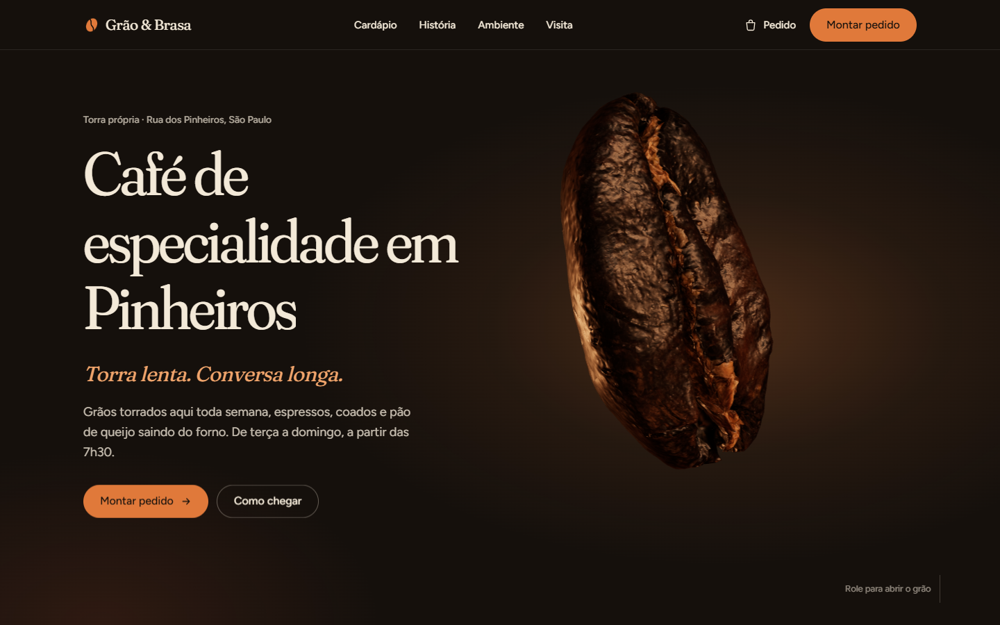
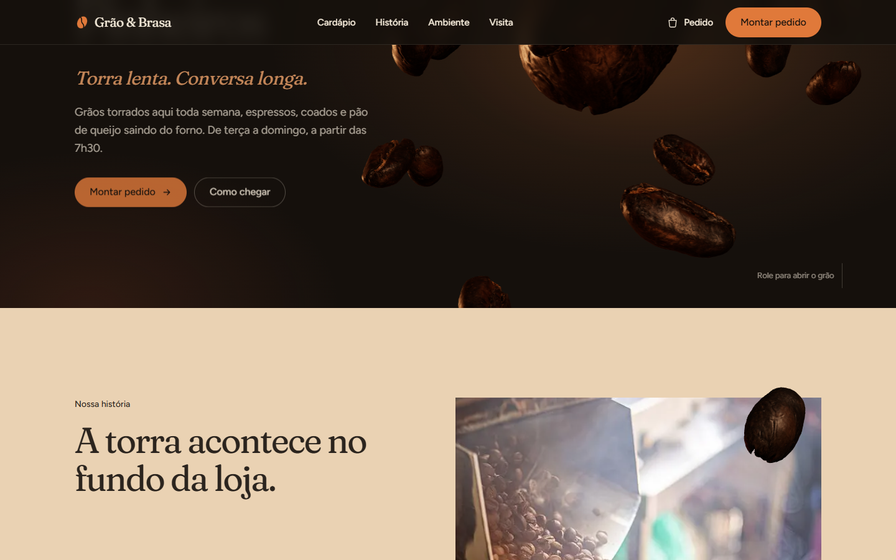
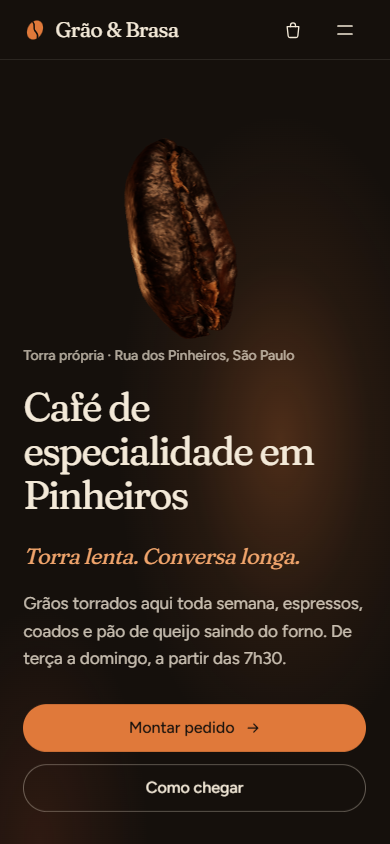

# Grão & Brasa: site de cafeteria com 3D

> **Projeto de estudo.** A "Grão & Brasa" é uma cafeteria **fictícia**: nome, depoimentos, preços, horários
> e endereço foram inventados para o exercício. Não representa nenhum negócio real.

Site de uma cafeteria de especialidade com um grão de café 3D real (escaneado por fotogrametria) no topo,
que gira, segue o mouse e se divide em vários grãos ao rolar a página. A página tem uma transição de cor
"noite → manhã", cardápio com filtros e um carrinho de retirada (demonstração).



| Grão se dividindo ao rolar | Celular |
|---|---|
|  |  |

## Tecnologias

- **Next.js** (export estático) + **TypeScript** + **Tailwind CSS 4**
- **React Three Fiber** + **drei** (Three.js) para o grão 3D, com fallback em imagem para aparelhos fracos
- **GSAP + ScrollTrigger** para animações de entrada e de scroll, e **Lenis** para a rolagem suave
- **HyperFrames** para o vídeo em loop da marca (16:9 e 9:16 para Reels)
- Respeita `prefers-reduced-motion`; layout pensado primeiro para o celular

## Estrutura

```
site/        o site (Next.js)
video/       os projetos de vídeo (HyperFrames): hero-loop (16:9) e reels-9x16
entregas/    vídeos renderizados e capturas de tela de QA
brief.md     o briefing do projeto
```

## Como rodar

Requer **Node.js 20+**.

```bash
cd site
npm install
npm run dev          # http://localhost:3000
```

Versão de produção:

```bash
npm run build        # gera site/out/
npx serve out -l 4173
```

No Windows dá para usar o atalho `abrir-site.bat`, que instala, gera e abre o site.

## Funcionalidades

- Grão 3D real no topo, com reação ao mouse e ao scroll, e detalhes 3D sutis em outras seções
- Cardápio com 5 categorias e filtros
- Carrinho com quantidades, validação de formulário e confirmação (salvo no navegador; **nada é enviado**)
- Galeria com foto ampliada e navegação por teclado
- Vídeo da marca em loop, pausado automaticamente fora da tela e com "reduzir movimento"

## Créditos

- **Grão 3D:** ["Coffee beans"](https://sketchfab.com/3d-models/coffee-beans-8146e99925fb4b49839e4fa7ace83f0f)
  por kouitimizuno, [CC BY 4.0](http://creativecommons.org/licenses/by/4.0/) (reduzido e comprimido para a web)
- **Fotos:** Wikimedia Commons e Unsplash, sob CC0, CC BY e CC BY-SA. A lista completa, com autores e
  links, está em [`site/public/img/credits.json`](site/public/img/credits.json) e no rodapé do site.
- **Fontes:** Fraunces e Figtree (Google Fonts, SIL Open Font License)
